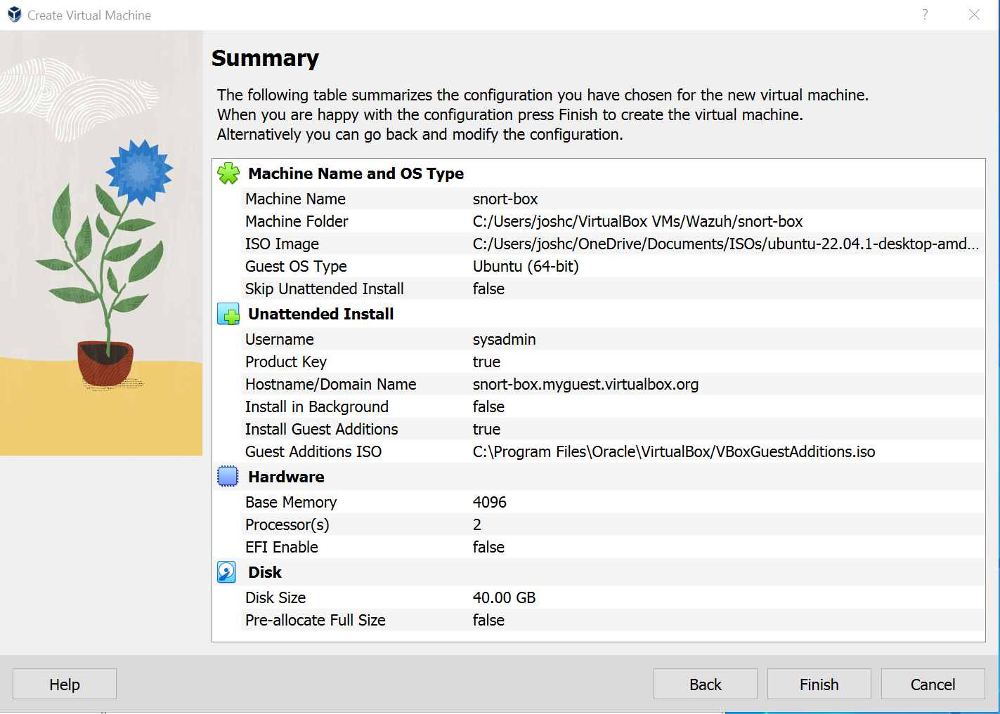
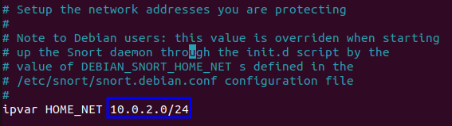

# Splunk-Snort-SIEM

<h1>Splunk SIEM with Snort IDS</h1>

<h2>Lab Description:</h2>

In this Repository you will find instructions on how to deploy a Splunk SIEM with logs forwarded from a Snort IDS. In walk through lab you will find each step to configure the enviroment.
> 
    ADD COMPLETION PHOTOS

<h2>Installation and configuration of Snort</h2>

In this section we will deploy a linux machine that properly runs Snort
 

Note prerequisites: virtual box installed and a copy of Ubuntu 22.0.04 ISO

Iso can be downloaded here: https://ubuntu.com/download/desktop

1. Create virtual machine with at least 2 CPU and 4 GB RAM  
   
2. Update and Upgrade machine:
   - sudo apt update && upgrade -y
3. Before the next step know your interface name and your IP address range. You will be required to enter them following the next step.
4. Install snort with the following command:
   - sudo apt-get install snort -y 
   When promted enter you address range and interface name
5. Now we need to edit the snort configuration file to add the ip range.
   - sudo nano /etc/snort/snort.conf 
    
6. Note in the snort configuration file view the location for local rules that we will create in future steps:
   - the location of the local rules is: /etc/snort/rules/local.rules
    
8. Test confirguation succesfullness with the following command:
    - sudo snort -T -i enp3s0 -c /etc/snort/snort.conf  
    - This command will test your your configuration. If it is correct it will show succesfull confirguation 

<section id="snort-rules">
  <h2>Snort Rules</h2>

  

    In this section, we will create custom local rules to help Snort IDS
    identify specific network activity. These rules demonstrate how
    signature-based detection can be used to monitor HTTP requests,
    ICMP traffic, TCP connection attempts, and other network behaviors.
  

  

    A useful tool for learning and building Snort rules is
    <a href="https://snorpy.com/" target="_blank" rel="noopener noreferrer">Snorpy</a>.
    It provides a graphical interface for constructing rule syntax.
    Always validate generated rules against your installed Snort version
    before using them.
  

  <h3>1. Edit the Local Rules File</h3>

  
Open the local rules file on the Ubuntu Snort sensor:

  <pre><code class="language-bash">sudo nano /etc/snort/rules/local.rules</code></pre>

  

    Add the rules below to the file. Each rule has a unique SID
    (Signature ID) so it can be identified in Snort alerts.
  

  <h3>2. Configure the Custom Rules</h3>

  <pre><code class="language-text"># Rule 1: Project Nightfall HTTP demo file request
alert tcp 192.168.1.5 any -&gt; 192.168.1.10 80 (msg:"NIGHTFALL HTTP Demo File Request"; flow:to_server,established; http_uri; content:"/downloads/security_patch.exe"; nocase; sid:1000001; rev:1;)

# Rule 2: ICMP ping request to Ubuntu
alert icmp any any -&gt; 192.168.1.5 any (msg:"LOCAL ICMP Echo Request To Ubuntu"; itype:8; sid:1000002; rev:1;)

# Rule 3: TCP SYN packets to Ubuntu
alert tcp any any -&gt; 192.168.1.5 any (msg:"LOCAL TCP SYN To Ubuntu"; flags:S; sid:1000003; rev:1;)

# Rule 4: HTTP request to admin path on Kali
alert tcp any any -&gt; 192.168.1.10 80 (msg:"LOCAL HTTP Admin Path Request"; flow:to_server,established; http_uri; content:"/admin"; nocase; sid:1000004; rev:1;)

# Rule 5: HTTP request for an EXE file on Kali
alert tcp any any -&gt; 192.168.1.10 80 (msg:"LOCAL HTTP EXE File Request"; flow:to_server,established; http_uri; content:".exe"; nocase; sid:1000005; rev:1;)

# Rule 6: HTTP request containing wp-admin
alert tcp any any -&gt; 192.168.1.10 80 (msg:"LOCAL HTTP WordPress Admin Path"; flow:to_server,established; http_uri; content:"wp-admin"; nocase; sid:1000006; rev:1;)

# Rule 7: UDP traffic from Ubuntu to DNS port
alert udp 192.168.1.5 any -&gt; any 53 (msg:"LOCAL Ubuntu DNS Traffic"; sid:1000007; rev:1;)

# Rule 8: SSH connection attempt to Ubuntu
alert tcp any any -&gt; 192.168.1.5 22 (msg:"LOCAL SSH Connection Attempt"; flags:S; sid:1000008; rev:1;)

# Rule 9: HTTP URI containing a path traversal pattern
alert tcp any any -&gt; 192.168.1.10 80 (msg:"LOCAL Possible HTTP Path Traversal"; flow:to_server,established; http_uri; content:"../"; sid:1000009; rev:1;)

# Rule 10: HTTP POST request to Kali
alert tcp any any -&gt; 192.168.1.10 80 (msg:"LOCAL HTTP POST Request"; flow:to_server,established; http_method; content:"POST"; sid:1000010; rev:1;)</code></pre>

  <h3>3. Save the Rules</h3>

  <ol>
    <li>Press <kbd>Ctrl</kbd> + <kbd>O</kbd> to save.</li>
    <li>Press <kbd>Enter</kbd> to confirm the filename.</li>
    <li>Press <kbd>Ctrl</kbd> + <kbd>X</kbd> to exit Nano.</li>
  </ol>

  <h3>4. Validate the Rules</h3>

  

    For Snort 3, validate the rules using your actual configuration path.
    The following example assumes the configuration is located at
    <code>/etc/snort/snort.lua</code>:
  

  <pre><code class="language-bash">sudo snort -T \
  -c /etc/snort/snort.lua \
  -R /etc/snort/rules/local.rules</code></pre>

  

    Review the command output for configuration or rule errors before
    starting Snort. Snort 2 and Snort 3 use different configuration
    conventions, so the command and rule compatibility must be checked
    for the installed version.
  

  <h3>5. Rule Overview</h3>

  <table>
    <thead>
      <tr>
        <th>SID</th>
        <th>Detection</th>
        <th>Purpose</th>
      </tr>
    </thead>
    <tbody>
      <tr>
        <td>1000001</td>
        <td>Nightfall demo file request</td>
        <td>Detects the specified HTTP URI from Ubuntu to Kali.</td>
      </tr>
      <tr>
        <td>1000002</td>
        <td>ICMP echo request</td>
        <td>Monitors ping requests directed at Ubuntu.</td>
      </tr>
      <tr>
        <td>1000003</td>
        <td>TCP SYN</td>
        <td>Observes initial TCP connection attempts to Ubuntu.</td>
      </tr>
      <tr>
        <td>1000004</td>
        <td>Admin path</td>
        <td>Flags HTTP URIs containing <code>/admin</code>.</td>
      </tr>
      <tr>
        <td>1000005</td>
        <td>EXE file request</td>
        <td>Flags

